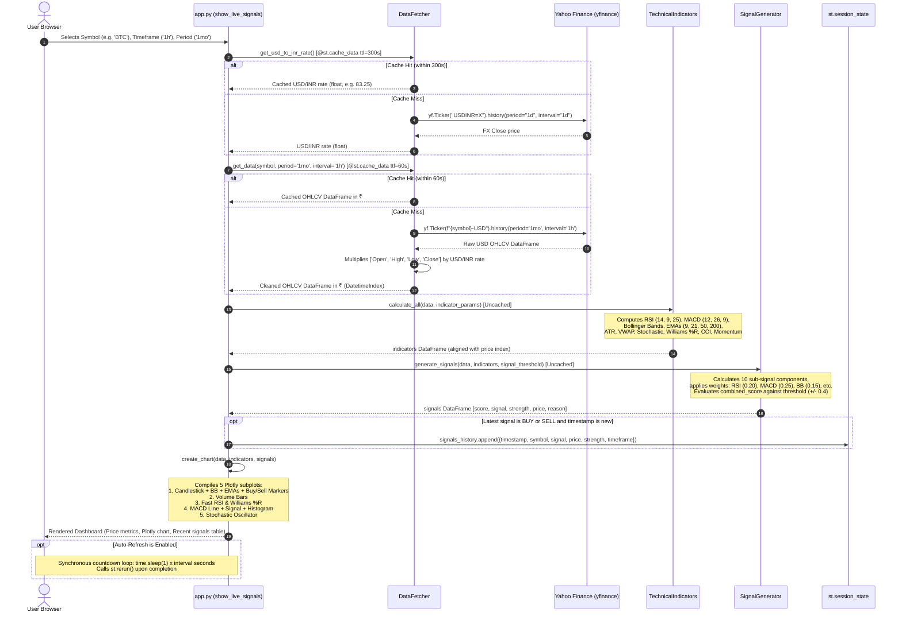
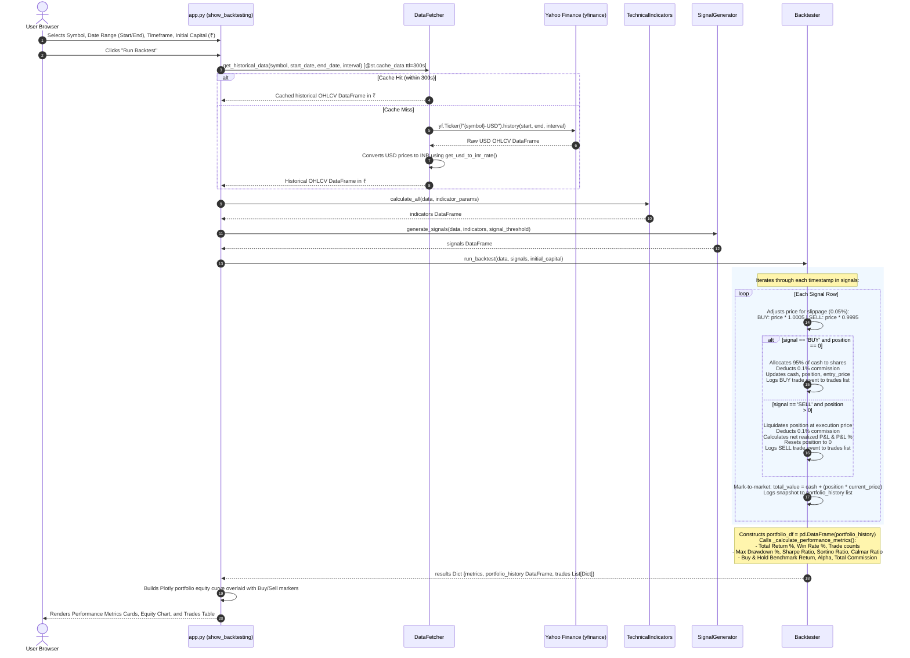

# TradeSignal System Architecture

## 1. System Overview

TradeSignal is a Streamlit-based cryptocurrency trading analytics and signal generation prototype designed for retail crypto enthusiasts and algorithmic trading learners who monitor market movements denominated in Indian Rupees (INR). The application aggregates market data via Yahoo Finance, converts USD quotations to INR using cached foreign exchange rates, computes technical analysis indicators, derives heuristic multi-factor trading signals (BUY, SELL, HOLD), and simulates historical strategy performance through a backtesting engine. **Explicitly out of scope** are production-grade requirements: there is **no persistent database storage** (all watchlists, alerts, and historical signals reside exclusively in volatile `st.session_state` and vanish upon server restart or session disconnect), **no real order routing or exchange connectivity** (no private API keys, execution pipelines, wallet management, or live brokerage integrations), and **no authentication, authorization, or multi-tenant security isolation**.

---

## 2. Module Graph Architecture

```mermaid
flowchart TD
    subgraph Client["Client Tier"]
        Browser["User Browser / Streamlit Frontend"]
    end

    subgraph AppCore["Application & State Management (app.py)"]
        Router["Streamlit Router & Page Controllers"]
        SessionStore[("st.session_state Store<br/>- watchlist: List[str]<br/>- signals_history: List[Dict]<br/>- alerts: List[Dict]")]
    end

    subgraph Analytics["Analytics & Processing Engine"]
        Fetcher["DataFetcher (data_fetcher.py)"]
        Indicators["TechnicalIndicators (technical_indicators.py)"]
        Signals["SignalGenerator (signal_generator.py)"]
        Backtest["Backtester (backtester.py)"]
    end

    subgraph External["External Data Providers"]
        YFinance["Yahoo Finance API (yfinance)"]
    end

    %% Client Interactions
    Browser -->|"User clicks, slider adjustments, page navigation"| Router
    Router -->|"HTML / Plotly Figures / Streamlit UI Components"| Browser

    %% Session State Interactions
    Router <-->|"Reads / Updates / Clears watchlist, signals_history, alerts"| SessionStore

    %% Data Acquisition Flow
    Router -->|"get_data(symbol, period, interval)"| Fetcher
    Router -->|"get_usd_to_inr_rate()"| Fetcher
    Router -->|"get_real_time_price(symbol)"| Fetcher
    Router -->|"get_historical_data(symbol, start, end, interval)"| Fetcher

    Fetcher -->|"yf.Ticker(symbol).history(...) -> USD OHLCV DataFrame"| YFinance
    Fetcher -->|"yf.Ticker('USDINR=X').history(...) -> FX Rate DataFrame"| YFinance
    Fetcher -->|"yf.Ticker(symbol).info -> Dict[str, Any]"| YFinance

    Fetcher -->>|"OHLCV DataFrame in ₹ [Open, High, Low, Close, Volume]"| Router
    Fetcher -->>|"Float FX Rate (e.g. 83.0)"| Router
    Fetcher -->>|"Dict: real-time price & volume stats in ₹"| Router

    %% Technical Analysis & Signal Flow
    Router -->|"calculate_all(data, params)<br/>Input: OHLCV DataFrame in ₹"| Indicators
    Indicators -->>|"DataFrame with ~25 Indicator Columns [rsi, macd, bb_*, ema_*, ...]"| Router

    Router -->|"generate_signals(data, indicators, threshold)<br/>Input: Price & Indicator DataFrames"| Signals
    Signals -->>|"DataFrame: [score, signal, strength, price, reason]"| Router

    %% Backtest Flow (Backtesting Page Only)
    Router -.->|"run_backtest(data, signals, initial_capital)<br/>(Backtesting Page Only)"| Backtest
    Backtest -.->|"Dict: metrics, portfolio_history DataFrame, trades List[Dict]"| Router
```

---

## 3. "Live Signals" Page Execution Sequence



---

## 4. "Backtesting" Page Execution Sequence



---

## 5. Page-to-Module & Session State Mapping Table

| Page Name | UI Function | Modules / Classes Invoked | Direct Functions Called | Session State Keys Touched | Purpose & Behavior |
| :--- | :--- | :--- | :--- | :--- | :--- |
| **Live Signals** | `show_live_signals()` | `DataFetcher`, `TechnicalIndicators`, `SignalGenerator`, `create_chart` (in `app.py`) | `DataFetcher.get_data()`, `DataFetcher.get_usd_to_inr_rate()`, `TechnicalIndicators.calculate_all()`, `SignalGenerator.generate_signals()`, `create_chart()` | `st.session_state.signals_history` *(Appends new BUY/SELL signal event if date is new)* | Fetches near real-time data (60s TTL), generates live indicators & signals, plots 5-pane interactive Plotly chart, and logs signals. |
| **Backtesting** | `show_backtesting()` | `DataFetcher`, `TechnicalIndicators`, `SignalGenerator`, `Backtester`, `plotly.graph_objects` | `DataFetcher.get_historical_data()`, `TechnicalIndicators.calculate_all()`, `SignalGenerator.generate_signals()`, `Backtester.run_backtest()` | *None* | Simulates strategy over historical window. Computes portfolio history, Sharpe/Sortino/drawdown metrics, and renders trade log. |
| **Watchlist** | `show_watchlist()` | `DataFetcher`, `TechnicalIndicators`, `SignalGenerator` | `DataFetcher.get_data()`, `TechnicalIndicators.calculate_all()`, `SignalGenerator.generate_signals()` | `st.session_state.watchlist` *(Reads list, appends new symbol, removes symbol)* | Displays user's monitored coin list with real-time price changes and quick signal status. Allows adding and deleting symbols. |
| **Signal History** | `show_signal_history()` | `pandas` | `pd.DataFrame()`, `DataFrame.to_csv()` | `st.session_state.signals_history` *(Reads list of logged signals, clears list to `[]`)* | Displays historical table of generated signals with multi-criteria filtering (symbol, signal type, date window) and CSV download. |
| **Smart Alerts** | `show_smart_alerts()` | `DataFetcher`, `pandas` | `DataFetcher.get_data()` *(to evaluate price against target)*, `pd.DataFrame()` | `st.session_state.alerts` *(Reads alert list, appends new alert dict, soft-deletes active flag)* | Allows configuring price target, RSI, and volume alerts. Evaluates active alerts against latest 5m candle close price. |
| **P&L Calculator** | `show_pnl_calculator()` | `numpy`, `pandas` | `np.random.normal()` *(in session trade simulation)*, `pd.DataFrame()` | `st.session_state.signals_history` *(Reads last 10 entries for "Analyze Session Trades")* | Interactive fee, slippage, and breakeven calculator for single trades, plus a pseudo-simulation batch analyzer for recent signals. |

*(Note: The global header functions `display_live_ticker()` and `main()` also invoke `DataFetcher.get_real_time_price()` and `DataFetcher.get_usd_to_inr_rate()` across every page render).*

---

## 6. Codebase Inconsistencies & Defect Register

During architectural verification of the codebase, several major inconsistencies, design contradictions, and latent defects were identified:

### 1. Fundamental Identity Conflict: Swing Trading vs. Scalping
- **The Conflict**: `replit.md` explicitly specifies the strategy as **"Swing trading (3-10 day holding periods)"** with medium-term indicators. Furthermore, internal docstrings in `technical_indicators.py` ("optimized for swing trading") and `signal_generator.py` ("Enhanced weights for swing trading") reflect a swing trading design.
- **The Contradiction**: `app.py`'s sidebar is hardcoded with the label **"Scalping Settings"** with the caption *"Optimized for fast trades"*, uses fast default parameters (Fast RSI: 7, MACD: 5/13/5, Bollinger: 10), provides default timeframes from 1m to 1h, and warns that 1d is *"Too slow for scalping"*. Chart titles and alert pages are likewise branded as "Scalping".
- **Impact**: Any developer or trader reviewing the system cannot determine whether the strategy is tuned for multi-day swing holds or high-frequency intraday scalping.

### 2. Deceptive / Fabricated Outcomes in "Analyze Session Trades"
- **The Defect**: In `show_pnl_calculator()` (`app.py`, lines 1063–1070):
  ```python
  simulated_exit_price = signal['price'] * (1 + np.random.normal(0, 0.02))
  simulated_quantity = 1000 / signal['price']
  ```
- **The Risk**: When the user clicks "Analyze Session Trades", the application manufactures synthetic exit prices using a Gaussian random generator (`np.random.normal(0, 0.02)`) and presents the resulting P&L, Win Rate %, and Avg Trade metrics side-by-side with real session data without any disclaimer indicating that these outcomes are purely random noise.

### 3. Look-Ahead Bias in Technical Indicators
- **The Defect**: In `technical_indicators.py`:
  - `calculate_market_structure()`: `data['High'].rolling(high_period, center=True).max()`
  - `calculate_support_resistance()`: `data['High'].rolling(window=window, center=True).max()`
- **The Risk**: Setting `center=True` incorporates future price bars into the calculation for bar $t$. In real-time trading or backtesting, future bars do not exist; using centered rolling windows creates severe look-ahead bias that artificially inflates backtest results and causes real-time signals to shift retroactively.

### 4. Broken Indicators and Chart Disconnects
- **Stochastic Subplot Never Renders**: In `app.py` (`create_chart`, line 836), the chart checks for `if 'stochastic_k' in indicators.columns:`. However, `TechnicalIndicators.calculate_stochastic()` produces columns named `'stoch_k'` and `'stoch_d'`. As a result, the Stochastic subplot is always blank.
- **Uncalculated Fast EMAs in Chart**: `create_chart` looks for `'ema_5'`, `'ema_8'`, `'ema_13'`, but `TechnicalIndicators.calculate_all()` only computes `'ema_9'`, `'ema_21'`, `'ema_50'`, and `'ema_200'`. The fast scalping EMAs are never added to the indicators DataFrame and never appear on the chart.
- **Dead Signal Methods**: In `signal_generator.py`, methods `_scalp_trend_signals`, `_velocity_signals`, `_squeeze_momentum_signals`, and `_moving_average_signals` are defined but never wired into `generate_signals()`.

### 5. Yahoo Finance Data Infeasibility for Intraday Scalping
- **The Defect**: `data_fetcher.py` relies exclusively on free Yahoo Finance (`yfinance`) endpoints:
  - 1-minute intraday bars are strictly limited by Yahoo to a maximum of 7 days of history. Requesting a period of `"1mo"` with interval `"1m"` (the default mapping for 30m/1h) fails or returns empty data.
  - Crypto trades 24/7/365, but the currency converter uses `USDINR=X`, a traditional forex quote that halts on weekends. During weekends, INR conversions either freeze on Friday's close or fall back to the static 83.0 constant.
  - Yahoo Finance intraday rate limits and connection throttling make sub-minute scalping dashboards prone to silent API failures.

### 6. Blocking UI Thread in Auto-Refresh Loop
- **The Defect**: In `app.py` (`show_live_signals`, lines 309–312):
  ```python
  for i in range(interval, 0, -1):
      placeholder.text(f"Next refresh in: {i} seconds")
      progress_bar.progress((interval - i) / interval)
      time.sleep(1)
  st.rerun()
  ```
- **The Risk**: Executing `time.sleep(1)` inside Streamlit's execution cycle freezes the Python worker thread for that session, locking out user interactions and UI responsiveness until the sleep loop finishes.

### 7. Fragile In-Memory Persistence (`st.session_state`)
- **The Defect**: User watchlists, alert rules, and recorded trading signals exist solely in memory within `st.session_state`. Any process recycle, autoscale pod restart, or browser session timeout permanently erases all user state.

### 8. Unrealistic Backtest Position Sizing & Zero Risk Control
- **The Defect**: `backtester.py` automatically commits **95% of total portfolio cash** to every single BUY signal (`shares_to_buy = int((portfolio['cash'] * 0.95) / execution_price)`), with zero position-sizing rules (e.g., fixed fractional or ATR volatility sizing) and no stop-loss or take-profit triggers. A single adverse price swing while holding a position can wipe out the simulated account. Furthermore, advanced analytical methods in `backtester.py` (`calculate_var`, `calculate_expected_shortfall`, `monte_carlo_simulation`) are dead code, never surfaced in the Streamlit UI.
