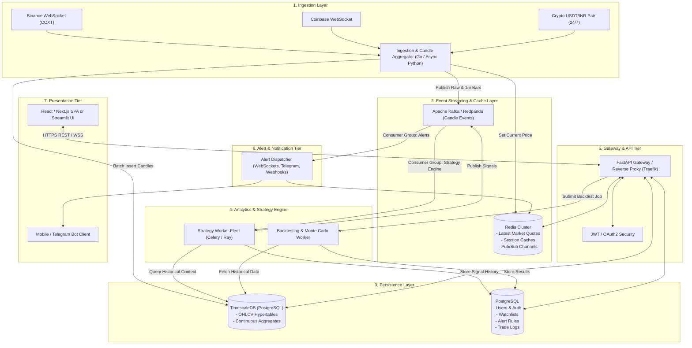
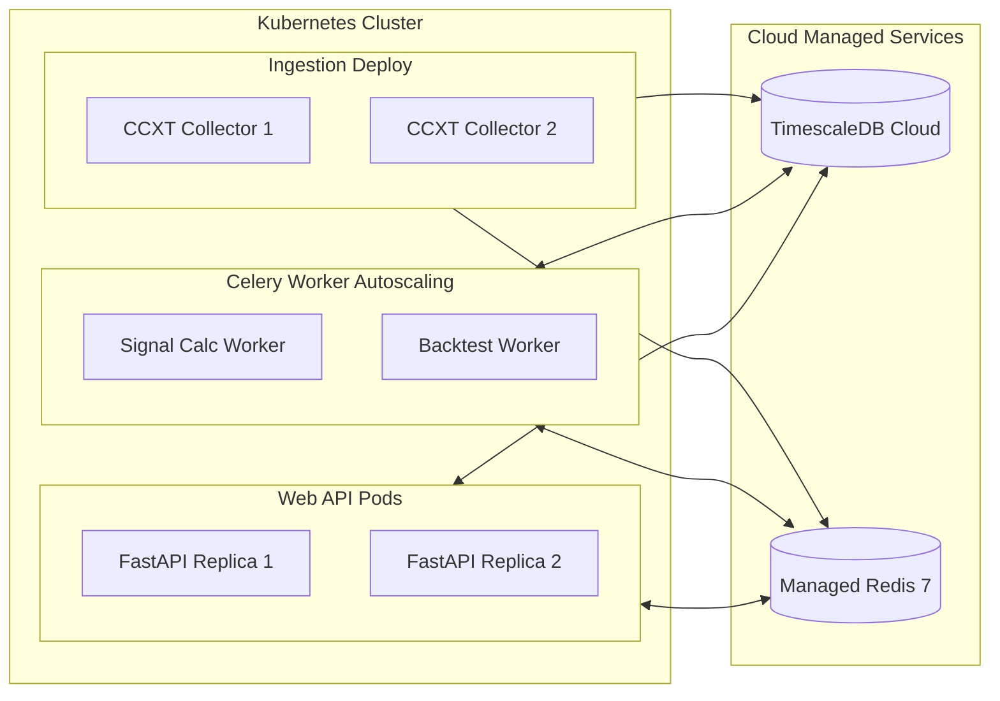

# TradeSignal Production System Design Document (SDD)

## 1. Executive Summary & Goals

The current TradeSignal repository represents a monolithic Streamlit prototype that combines data fetching, mathematical analysis, heuristic signal generation, and UI presentation within a single Python runtime. 

This document outlines the **Target Production System Design** required to transform this prototype into an enterprise-grade, high-availability, low-latency cryptocurrency signal and execution intelligence platform.

### 1.1 Key Objectives
- **Reliable Intraday Streaming**: Transition from delayed, throttled Yahoo Finance polling to direct multi-exchange WebSocket streams (Binance, Coinbase, Kraken via CCXT).
- **Zero Look-Ahead Bias**: Formally verified, causal indicator pipelines with deterministic backtesting.
- **Persistent State**: Decouple state from ephemeral browser sessions into durable relational and time-series datastores.
- **Asynchronous Event-Driven Architecture**: Decouple compute-heavy indicator/signal calculations from UI rendering.
- **Enterprise Risk Management**: Replace hardcoded 95% cash allocations with dynamic position sizing, hard stop-losses, and portfolio exposure controls.

---

## 2. Requirements Specification

### 2.1 Functional Requirements (FR)
1. **Multi-Source Market Ingestion**: Stream real-time L1 tick data and aggregate OHLCV candles across multiple granularities (1m, 5m, 15m, 1h, 4h, 1d).
2. **Real-time FX Normalization**: Ingest live USD/INR exchange rates from 24/7 crypto stablecoin pairs (USDT/INR) rather than traditional banking-hours forex.
3. **Pluggable Indicator & Strategy Engine**: Support user-configurable trading strategies combining trend-following, momentum, mean-reversion, and volume profile heuristics.
4. **Deterministic Walk-Forward Backtester**: Execute in-sample parameter tuning with out-of-sample forward testing, Monte Carlo stress tests, and slippage modeling.
5. **Multi-Channel Alert Dispatcher**: Deliver alerts via WebSockets, Telegram, Discord, and Webhooks within < 500ms of candle close.
6. **Portfolio & P&L Analytics**: Accurately track simulated paper trades and real execution fill logs with true entry/exit timestamps.

### 2.2 Non-Functional Requirements (NFR)
- **Latency**: Signal calculation complete within **< 100ms** of bar close.
- **Availability**: 99.9% uptime for ingestion and alert generation workers.
- **Data Durability**: Guaranteed persistence of historic candles, user configurations, and audit trails.
- **Scalability**: Capable of tracking 500+ trading pairs concurrently without performance degradation.
- **Stateless Web Tier**: Horizontal scalability of user-facing dashboards.

---

## 3. High-Level Architecture (Target State)



---

## 4. Subsystem Detailed Design

### 4.1 Market Data Ingestion & FX Normalization
- **Primary Exchanges**: Binance, Bybit, OKX via public WebSocket trade feeds (`<symbol>@kline_<interval>` and `<symbol>@trade`).
- **Candle Synthesis**: An in-memory tumbling-window aggregator aggregates tick-by-tick trades into exact 1m candles.
- **24/7 INR Valuation**: Rather than relying on Yahoo Finance's `USDINR=X` (which closes on Friday afternoons), use real-time `USDT/INR` pairs from liquid Indian or P2P/global markets (e.g., CoinDCX, WazirX, or Binance P2P rate indexing).
- **Staleness Circuit Breakers**: If no heartbeat tick is received within $2 \times \text{interval}$, flag the symbol data as STALE and suppress trading signals.

### 4.2 Time-Series & Relational Data Models

#### TimescaleDB Candle Hypertable (`candles`):
```sql
CREATE TABLE market_candles (
    timestamp       TIMESTAMPTZ NOT NULL,
    symbol          VARCHAR(20) NOT NULL,
    exchange        VARCHAR(20) NOT NULL,
    timeframe       VARCHAR(10) NOT NULL,
    open            NUMERIC(18, 8) NOT NULL,
    high            NUMERIC(18, 8) NOT NULL,
    low             NUMERIC(18, 8) NOT NULL,
    close           NUMERIC(18, 8) NOT NULL,
    volume          NUMERIC(24, 8) NOT NULL,
    usd_inr_rate    NUMERIC(10, 4) NOT NULL
);
SELECT create_hypertable('market_candles', 'timestamp');
CREATE INDEX idx_symbol_tf_time ON market_candles (symbol, timeframe, timestamp DESC);
```

#### Signal Registry Table (`signals`):
```sql
CREATE TABLE trading_signals (
    signal_id       UUID PRIMARY KEY DEFAULT gen_random_uuid(),
    timestamp       TIMESTAMPTZ NOT NULL,
    symbol          VARCHAR(20) NOT NULL,
    timeframe       VARCHAR(10) NOT NULL,
    signal_type     VARCHAR(10) NOT NULL CHECK (signal_type IN ('BUY', 'SELL', 'HOLD')),
    score           NUMERIC(5, 4) NOT NULL,
    strength        NUMERIC(5, 4) NOT NULL,
    price_inr       NUMERIC(18, 2) NOT NULL,
    indicators_json JSONB NOT NULL,
    reasons         TEXT[] NOT NULL,
    created_at      TIMESTAMPTZ DEFAULT NOW()
);
```

#### Alert Configuration Table (`alerts`):
```sql
CREATE TABLE user_alerts (
    alert_id        UUID PRIMARY KEY DEFAULT gen_random_uuid(),
    user_id         UUID NOT NULL,
    symbol          VARCHAR(20) NOT NULL,
    alert_type      VARCHAR(30) NOT NULL, -- 'PRICE_TARGET', 'RSI_EXTREME', 'MACD_CROSS'
    condition_expr  JSONB NOT NULL,       -- e.g. {"operator": ">=", "target_price": 5000000}
    destination     VARCHAR(20) NOT NULL, -- 'WEBSOCKET', 'TELEGRAM', 'EMAIL'
    destination_target VARCHAR(100) NOT NULL,
    is_active       BOOLEAN DEFAULT TRUE,
    created_at      TIMESTAMPTZ DEFAULT NOW(),
    last_triggered  TIMESTAMPTZ
);
```

---

## 5. Strategy & Indicator Architecture

### 5.1 Strict Anti-Lookahead Guarantee
All indicators must strictly operate as causal rolling filters. Moving averages, channels, and momentum oscillators are computed using slice bounds `[:t]`.
- **Elimination of `center=True`**: Any pivot or support/resistance identification must use a causal delay $k$: a pivot at bar $t-k$ is only confirmed at bar $t$ when $k$ subsequent lower/higher bars have fully closed.

### 5.2 Composable Strategy Pattern (OOP Design)

```
                    ┌─────────────────────────┐
                    │      <<interface>>      │
                    │      TradingRule        │
                    ├─────────────────────────┤
                    │ + evaluate(df) -> Series│
                    │ + weight -> float       │
                    └────────────▲────────────┘
                                 │
         ┌───────────────────────┼───────────────────────┐
         │                       │                       │
┌────────────────┐      ┌────────────────┐      ┌────────────────┐
│   RSIRule      │      │   MACDCross    │      │ BollingerBand  │
└────────────────┘      └────────────────┘      └────────────────┘
         ▲                       ▲                       ▲
         └───────────────────────┼───────────────────────┘
                                 │
                    ┌─────────────────────────┐
                    │      StrategyEngine     │
                    ├─────────────────────────┤
                    │ - rules: List[Rule]     │
                    │ - threshold: float      │
                    ├─────────────────────────┤
                    │ + evaluate_signals()    │
                    └─────────────────────────┘
```

---

## 6. Risk Management & Backtesting Engine

### 6.1 Position Sizing & Capital Allocation
Instead of the current naive `int(cash * 0.95 / price)`, the production engine introduces:
1. **Fixed Fractional Risk**:
   $$\text{Position Size} = \frac{\text{Portfolio Cash} \times \text{Risk Fraction } (1\%)}{\text{Entry Price} - \text{Stop Loss Price}}$$
2. **Volatility / ATR Sizing**: Position size inversely proportional to the 14-period Average True Range.
3. **Hard Portfolio Guardrails**:
   - Maximum 20% of capital allocated to any single asset.
   - Max 3 concurrent open positions across the entire portfolio.
   - Mandatory ATR trailing stop (e.g., $2.5 \times \text{ATR}$).

### 6.2 Realistic Execution Simulation
- **Slippage**: Nonlinear slippage model based on order size relative to 1m bar volume:
  $$\text{Slippage} = \text{base\_slippage} + \gamma \left(\frac{\text{Trade Size}}{\text{Bar Volume}}\right)^2$$
- **Exchange Fees**: Tiered maker/taker fee structures (0.10% taker / 0.05% maker).
- **Walk-Forward Validation**: Train heuristic weights on $W_1$ (e.g., 6 months), validate out-of-sample on $W_2$ (1 month), and step forward continuously.

---

## 7. Operational Topology & Deployment



### 7.1 Observability Stack
- **Prometheus**: Metrics collection on tick arrival rates, signal latency, and Redis queue depths.
- **Grafana**: Real-time engineering dashboard tracking data pipeline health and market feed uptime.
- **Loki / OpenSearch**: Structured JSON log aggregation with contextual trace IDs per signal evaluation.
